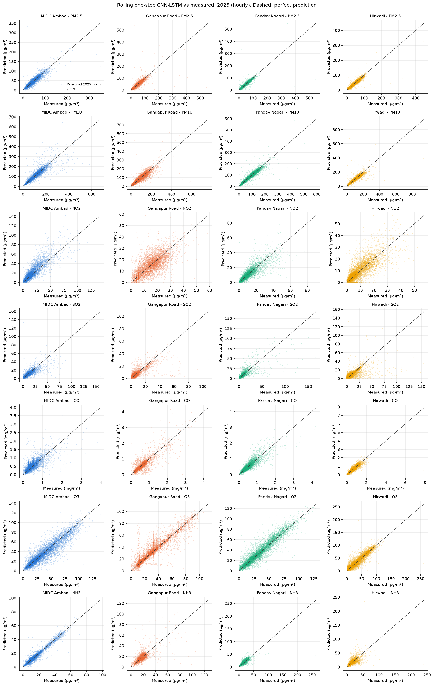
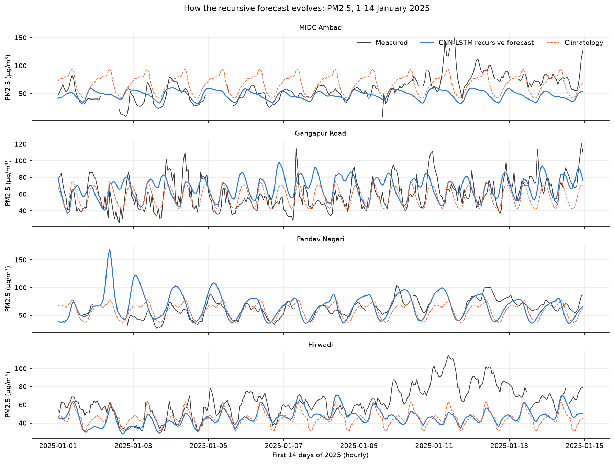

# Nashik Air-Quality Prediction with a CNN-LSTM

A student project that predicts hourly air pollution at four monitoring stations in Nashik, India, using a deep-learning model (CNN-LSTM). It also checks honestly how good those predictions are.

**Main result in one paragraph.** One hour ahead, the CNN-LSTM is slightly more accurate than the simplest possible guess ("next hour = the latest measured value"). In the 2025 test it beats that guess for 22 of 28 station-pollutant series, with a typical (median) error reduction of 5.8%. On the measured part of 2026 it wins 12 of 17 usable series (median 4.4%). When the same model is used to forecast a whole year by feeding it its own predictions, it is worse than simply using the historical average for each month and hour. It beats that average for only 3 of 28 series in 2025 and 2 of 17 in 2026. So the model is useful for **next-hour** prediction, and **not** for full-year forecasting.

---

## A. Project overview

Air pollution harms health, especially fine particles (PM2.5) and gases such as NO2 and O3. Hour-by-hour predictions can support health warnings and short-term decisions, such as limiting traffic or industrial emissions on a bad day.

This project:

1. Cleans four years of hourly measurements from four Nashik stations and removes faulty sensor readings.
2. Trains one CNN-LSTM per station that reads the **last 24 hours** of seven pollutants and predicts all seven for the **next hour**.
3. Tests the model on data it has never seen: all of 2025, and the part of 2026 that has been measured.
4. Compares the model with simple baselines, so that the reported accuracy means something.
5. Converts predicted concentrations into a daily CPCB Air Quality Index (AQI). This is a model estimate, not an official AQI bulletin.

The model predicts **pollutant concentrations** (for example, PM2.5 in µg/m³). It does not predict the AQI directly.

## B. Monitoring stations and dataset

There are four CSV files, one per station. They are not stored in this repository (`data/` is git-ignored). Put them in `data/` before running.

| Station | File name | First measurement | Last measurement | Notes |
|---|---|---|---|---|
| Gangapur Road | `combined_gangapur_road_nashik.csv` | 2017-01-01 | 2026-08-31 | Longest history; several faulty gas sensors (see below) |
| MIDC Ambad | `MIDCAMBAD_NASHIK.CSV` | 2023-06-14 | 2026-08-31 | |
| Hirwadi | `hirwadi_nashik.csv` | 2023-05-23 | 2026-08-31 | File rows are out of order (the code sorts them) |
| Pandav Nagari | `combined_pandav_nagari_nashik.csv` | 2023-05-22 | **2025-12-31** | Fewest missing values; **no 2026 data** |

**Seven pollutants** are used, both as model inputs and as prediction targets:

| Pollutant | What it is | Unit |
|---|---|---|
| PM2.5 | Fine particles (≤ 2.5 µm) | µg/m³ |
| PM10 | Coarse and fine particles (≤ 10 µm) | µg/m³ |
| NO2 | Nitrogen dioxide (mainly traffic) | µg/m³ |
| SO2 | Sulphur dioxide (mainly industry, fuel) | µg/m³ |
| CO | Carbon monoxide (incomplete burning) | mg/m³ |
| O3 | Ozone (formed in sunlight) | µg/m³ |
| NH3 | Ammonia (agriculture, waste) | µg/m³ |

The files also contain other gases and weather columns (temperature, humidity, wind, rain). **The model does not use them.**

**Coverage and missing values**

- Each row is one hourly average. Before cleaning, 3–17% of hourly values are missing per station and pollutant. Pandav Nagari has the fewest gaps; Gangapur Road has the most.
- **July 2026 is missing from every file.** September–December 2026 are not in the data.
- Pandav Nagari's file ends on 31 December 2025, so it has **no 2026 measurements**.
- Three stations start in mid-2023, so they have only about 2.5 years of history.

**Known data-quality problems.** These are found and removed automatically by the cleaning rules in section C:

- **Gangapur Road NO2** stays almost constant at about 3.85 µg/m³ from late August 2025 (a failed sensor).
- **Gangapur Road NH3** is stuck at about 12 µg/m³ in 2026.
- **CO** reads exactly 0.00 mg/m³, or stays stuck, for months in 2026 at MIDC Ambad, Gangapur Road and Hirwadi.
- Gangapur Road also has older near-constant periods: for example, O3 at 45.0 µg/m³ from December 2021 to March 2022, and NO2 at 6.28 µg/m³ from March to June 2023.
- In January–May 2026, many values are reported as whole numbers. This looks like a change in reporting precision, and those values are kept.

## C. How the project works

```
Raw CSVs → Cleaning → Feature scaling → KNN imputation → 24-hour sequences
        → CNN-LSTM training → Next-hour prediction → Evaluation against baselines
```

**1. Data cleaning.** A value is set to "missing" when it is clearly not a real measurement:

| Rule | Why |
|---|---|
| Negative value | A concentration cannot be negative (none occur) |
| PM2.5 or PM10 ≥ 999 | The analyser's upper limit, not a real value |
| The same value repeated for 12 or more hours | A stuck sensor |
| CO exactly 0.00 mg/m³ | Outdoor CO is never zero (the clean-air background is about 0.1 mg/m³) |
| **Flatline day:** a day with at least 12 values where the spread (90th minus 10th percentile) is under 5% of the median | A failed sensor that jitters around a fixed level |

Real pollution changes a lot during a day, so the flatline rule removes only near-constant days. **It can never remove a pollution peak.** For example, the Diwali 2025 PM2.5 peak at Hirwadi (447 µg/m³) is kept. Every removed value is counted in `tables/cleaning_log.csv`. In the prediction files, those hours are labelled `removed_by_quality_check`.

**2. Feature scaling.** The pollutants have very different sizes: CO is around 0.5 mg/m³, while PM10 is often above 100 µg/m³. A `StandardScaler` rescales each pollutant to mean 0 and standard deviation 1, so that no pollutant dominates just because its numbers are bigger.

**3. KNN imputation (filling missing inputs).** The model needs a number in every input cell. For a missing value, the `KNNImputer` finds the 5 most similar hours (similar = close values of the other pollutants in that hour) and uses their weighted average, giving closer hours more weight.

- It is fitted on training data only. **Every training row is a possible donor; no sample is drawn.**
- If all seven pollutants are missing in an hour, there is nothing to compare, so the training average is used.
- Filled values are only used as **inputs**. A missing **target** value is never filled in; it is simply not scored.

**4. Creating 24-hour sequences.** Each training example is a window of 24 consecutive hours (the input) followed by the next hour (the target). A window is used only if:

- its 25 hours are consecutive;
- at most half of its input values were filled in by KNN;
- at least one pollutant is measured at the target hour.

**5. CNN-LSTM training.** One model per station is trained to predict the next hour. The training data and validation data both come from **before** the test period.

**6. Predicting the next hour.** The trained model reads the latest 24 hours and outputs seven concentrations. Negative outputs are set to 0.

**7. Evaluation.** Predictions are converted back to real units and compared with **measured** values only. Each result is compared with a simple baseline on exactly the same hours.

## D. Model explanation

- **CNN (convolutional neural network)** layers slide a small filter over the 24-hour window and learn short patterns, such as a sharp morning rise.
- **LSTM (long short-term memory)** is a recurrent layer that reads the sequence in order and remembers what matters across hours.
- Combining them is a common design for hourly air-quality data.

**Input:** 24 hours × 13 features:

- the 7 scaled pollutants;
- 6 time features: sine and cosine of hour of day, day of week and month. These tell the model when each hour is. They are known in advance for any future hour.

**Output:** 7 numbers, one per pollutant, for the next hour.

**Why 24 hours?** Pollution follows a daily cycle (traffic peaks, sunlight-driven ozone), and 24 hours covers one full cycle. Longer windows (48 or 168 hours) were not tested in this pipeline.

**Two target designs.** Each station trains the same network twice:

- **level:** predict the next value directly;
- **change:** predict the difference from the last hour in the input window, then add it back.

The design is chosen on validation data, separately for one-step and for recursive prediction.

**Hyperparameters** (read from `nashik_aq_pipeline.py`; the same for every station, with no tuning search):

| Setting | Value |
|---|---|
| Layers | Conv1D(64 filters, kernel 3, causal, ReLU) → Conv1D(64, 3, causal, ReLU) → MaxPooling1D(2) → LSTM(64) → Dropout(0.2) → Dense(32, ReLU) → Dense(7) |
| Trainable parameters | 50,247 per station model |
| Lookback | 24 hours |
| Loss | Mean squared error, only over measured targets |
| Optimiser | Adam, learning rate 0.001 |
| Batch size | 256 |
| Epochs | up to 60, early stopping on validation loss (patience 6, best weights restored) |
| KNN imputer | `n_neighbors=5`, `weights="distance"`, all training rows as donors |
| Random seed | 42 |

## E. Training and testing

The data is always split **by time**, never randomly. A random split would let the model learn from hours that sit right next to the test hours.

| Experiment | Network trained on | Validation (early stopping, design choice) | Test |
|---|---|---|---|
| **2025 backtest** | start → 30 June 2024 | 1 July – 31 December 2024 | all of 2025, all 4 stations |
| **2026 evaluation** | start → 30 June 2025 | 1 July – 31 December 2025 | Jan–Jun and Aug 2026 at 3 stations (partial year) |

The scaler, the KNN imputer, the network weights and the design choice use only data from before the test year.

**Two ways of predicting, explained with an example.** Suppose it is midnight on 1 January 2025 and we want PM2.5 for every hour of 2025.

- **Rolling one-step prediction** (the realistic use). At 09:00 on 5 March, the model receives the **real measurements** from 08:00 back to 09:00 the previous day, and predicts 10:00. An hour later, the new real measurement arrives and the window moves on. Every prediction is only one hour ahead.
- **Recursive forecast** (whole year, no future data). The model predicts 01:00 on 1 January. That **prediction** is then treated as if it were a measurement and used to predict 02:00, and so on for all 8,760 hours. Only the starting 24 hours are real, so any error is fed back and can grow.

**Baselines** (simple methods the model must beat):

- **Persistence**, for next-hour prediction: the next hour equals the latest measured value.
- **Climatology**, for the recursive full-year forecast: the average measured value for the same calendar month and hour of day, from all data before the test year.

**Metrics** (all in real units, on measured hours only):

- **MAE:** the average size of the error.
- **RMSE:** like MAE, but punishes large errors more.
- **R²:** how much of the variation is explained (1 = perfect, 0 = no better than always predicting the average, negative = worse than that).
- **Skill** = 1 − RMSE(model) / RMSE(baseline). Positive means the model beats the baseline; 0.05 means 5% lower error.

## F. Results

All numbers below come from `outputs/<mode>/metrics/` and were checked by `scripts/verify_outputs.py`. A "series" is one pollutant at one station.

- The 2025 test has 28 series.
- The partial 2026 evaluation has 17 usable series, out of 21 at the three stations with 2026 data. Four are excluded because they are still faulty after cleaning (fewer than 100 distinct values): CO at MIDC Ambad, and NO2, CO and NH3 at Gangapur Road.

**Summary**

| Comparison | 2025 (full year) | 2026 (Jan–Jun, Aug; 3 stations) |
|---|---|---|
| Next hour: CNN-LSTM beats persistence | 22 of 28 series, median skill +5.8% | 12 of 17 series, median skill +4.4% |
| Whole year, recursive: CNN-LSTM beats climatology | 3 of 28 series, median skill −38.4% | 2 of 17 series, median skill −54.0% |

**1. Next-hour (rolling one-step) prediction vs persistence.** The rows pool all usable stations for each pollutant. Units are µg/m³, and mg/m³ for CO.

| Year | Pollutant | Hours | MAE model | MAE persistence | RMSE model | RMSE persistence | R² model | R² persistence | Skill |
|---|---|---|---|---|---|---|---|---|---|
| 2025 | PM2.5 | 33,013 | 4.78 | 4.76 | 10.5 | 11.2 | 0.82 | 0.80 | +6.5% |
| 2025 | PM10 | 33,010 | 10.2 | 10.7 | 22.5 | 24.0 | 0.81 | 0.78 | +6.0% |
| 2025 | NO2 | 29,792 | 3.31 | 2.92 | 5.43 | 5.24 | 0.71 | 0.73 | −3.7% |
| 2025 | SO2 | 32,732 | 2.35 | 2.34 | 6.13 | 6.67 | 0.54 | 0.46 | +8.1% |
| 2025 | CO | 32,845 | 0.084 | 0.078 | 0.170 | 0.178 | 0.74 | 0.72 | +4.7% |
| 2025 | O3 | 32,777 | 5.23 | 5.22 | 8.53 | 9.17 | 0.85 | 0.83 | +7.0% |
| 2025 | NH3 | 29,460 | 2.13 | 2.04 | 4.97 | 5.22 | 0.67 | 0.63 | +4.8% |
| 2026 | PM2.5 | 13,438 | 4.22 | 4.29 | 8.37 | 8.44 | 0.80 | 0.79 | +0.8% |
| 2026 | PM10 | 13,435 | 9.18 | 9.81 | 17.1 | 19.1 | 0.83 | 0.78 | +10.4% |
| 2026 | NO2 | 8,721 | 2.61 | 2.59 | 4.48 | 4.93 | 0.82 | 0.78 | +9.1% |
| 2026 | SO2 | 12,984 | 1.83 | 1.77 | 5.43 | 5.50 | 0.64 | 0.63 | +1.3% |
| 2026 | CO (Hirwadi only) | 1,989 | 0.076 | 0.060 | 0.159 | 0.151 | 0.76 | 0.78 | −5.8% |
| 2026 | O3 | 13,551 | 5.06 | 4.97 | 9.63 | 10.1 | 0.79 | 0.77 | +4.5% |
| 2026 | NH3 (MIDC Ambad, Hirwadi) | 8,921 | 2.28 | 2.20 | 5.74 | 6.00 | 0.28 | 0.22 | +4.2% |

How to read this:

- The model's R² of about 0.8 looks impressive, but **persistence scores almost the same R²**. Hourly pollution changes slowly, so a high R² is easy here.
- The real gain is the skill column: the model's RMSE is usually 4–10% lower than persistence's.
- MAE gains are smaller still. Sometimes MAE is slightly worse while RMSE is better, which means the model mainly helps on large hour-to-hour changes.
- NO2 in 2025 and CO in 2026 are worse than persistence.

**2. Full-year recursive forecast vs climatology.** The same pooling applies.

| Year | Pollutant | Hours | RMSE model | RMSE climatology | R² model | R² climatology | Skill |
|---|---|---|---|---|---|---|---|
| 2025 | PM2.5 | 33,410 | 67.5 | 20.9 | −6.23 | 0.31 | −223.0% |
| 2025 | PM10 | 33,406 | 53.8 | 44.5 | −0.10 | 0.25 | −20.9% |
| 2025 | NO2 | 30,084 | 20.2 | 13.0 | −3.06 | −0.67 | −55.9% |
| 2025 | SO2 | 33,161 | 12.7 | 8.88 | −0.98 | 0.04 | −43.6% |
| 2025 | CO | 33,261 | 0.547 | 0.341 | −1.66 | −0.03 | −60.5% |
| 2025 | O3 | 33,204 | 45.6 | 19.1 | −3.29 | 0.24 | −138.3% |
| 2025 | NH3 | 29,740 | 17.2 | 9.91 | −3.02 | −0.33 | −73.9% |
| 2026 | PM2.5 | 14,353 | 42.5 | 16.1 | −4.21 | 0.25 | −163.8% |
| 2026 | PM10 | 14,333 | 96.9 | 31.1 | −4.60 | 0.42 | −211.8% |
| 2026 | NO2 | 8,981 | 16.5 | 8.70 | −1.42 | 0.32 | −89.1% |
| 2026 | SO2 | 13,574 | 15.4 | 8.28 | −1.94 | 0.15 | −86.1% |
| 2026 | CO (Hirwadi only) | 2,099 | 0.294 | 0.329 | 0.17 | −0.05 | +10.6% |
| 2026 | O3 | 14,468 | 32.4 | 24.8 | −1.44 | −0.44 | −30.3% |
| 2026 | NH3 | 9,202 | 21.8 | 7.30 | −9.46 | −0.17 | −198.6% |

The recursive forecast drifts away from reality:

- In 2025, its MIDC Ambad PM2.5 forecast has monthly means of 121–223 µg/m³ from January to July. The measured monthly means were 25–63.
- In 2026, its Hirwadi PM2.5 forecast stays at 90–102 µg/m³ every month from January to September. The measured monthly means were 12–48.

Negative R² means the forecast is worse than always predicting the average. **Do not use the recursive CNN-LSTM as a year-ahead forecast.**

**3. Hours excluded as sensor faults.** These are hours in the test period that had a value but were removed by the cleaning rules (out of 8,760 per series).

| Test period | Largest exclusions |
|---|---|
| 2025 | Gangapur Road NO2 3,057 h, NH3 3,039 h, O3 575 h, CO 469 h; at most 157 h for any other series |
| 2026 | CO: Gangapur Road 4,901 h, MIDC Ambad 3,077 h, Hirwadi 2,672 h; Gangapur Road NO2 4,498 h and NH3 4,752 h |

Excluding faulty hours changes the conclusions. The earlier, uncleaned evaluation counted 21 series in 2026, including stuck sensors, where persistence looks unbeatable (for example, Gangapur Road NH3). Those series now get no score instead of a misleading one.

**Graphs**

- Next-hour predictions vs measurements, 2025: `outputs/backtest_2025/figures/fig10_scatter_one_step.png`.
- How the recursive forecast drifts in the first two weeks: `outputs/backtest_2025/figures/fig05b_first_two_weeks_pm25.png`.
- Recursive forecast vs measurements for the whole year, one file per station: `outputs/backtest_2025/figures/fig05_forecast_<station>.png`.
- RMSE by month of the year: `outputs/backtest_2025/figures/fig09_rmse_by_month.png`.





Per-station results for every pollutant are in `outputs/<mode>/metrics/one_step_station_pollutant_metrics.csv` and `recursive_station_pollutant_metrics.csv`. The report (section I) explains all of them.

## G. Limitations

- **Faulty sensors.** Removed by rules, not by hand. The rules are heuristics: some degraded readings may remain (for example, CO in mid-2025 changes only in steps of 0.01 mg/m³, and is kept), and the removed periods are counted in the outputs.
- **Partial 2026 data.** There are measurements for January–June and August only, at three stations. July and September–December are missing, and Pandav Nagari has nothing. The 2026 results cover most of the winter and summer but not the monsoon, so **they are not a full-year accuracy assessment.**
- **Different station histories.** Gangapur Road goes back to 2017. The other three start in mid-2023, so the 2025 backtest models for those stations saw only about one year of training data, with one winter.
- **No weather inputs.** Weather (wind, rain, temperature, humidity) drives much of the day-to-day change in pollution. It is in the files for three stations, but the model does not use it. A year-ahead forecast could only use weather if weather forecasts were available.
- **Full-year recursive forecasts.** A one-hour-ahead model fed its own outputs for 8,760 steps accumulates error. It does not beat climatology, and some forecast months are physically implausible. The 2026 forecast file (`outputs/forecast_2026/predictions/recursive_forecast.csv`) contains every hour of 2026; use its `climatology_pred` column, not `cnn_lstm_pred`, as the year-ahead estimate.
- **One training run per model** (seed 42), so there are no uncertainty ranges.

## H. How to run the project in Google Colab

You need the four station CSV files (section B).

1. Open <https://colab.research.google.com> and choose **File → New notebook**. A CPU runtime is enough.
2. Get the code (paste into a cell and run):
   ```
   !git clone https://github.com/parth-sharma-10/nashik-aqi-cnn-lstm.git
   %cd nashik-aqi-cnn-lstm
   ```
3. Install the one package Colab does not already have (Colab already includes TensorFlow, pandas, scikit-learn and matplotlib):
   ```
   !pip install -q python-docx
   ```
4. Put the four CSV files in `data/`. Use **either** option.
   - **Upload from your computer:**
     ```python
     import os, shutil
     from google.colab import files
     os.makedirs("data", exist_ok=True)
     for name in files.upload():
         shutil.move(name, f"data/{name}")
     ```
   - **Copy from Google Drive** (change the folder path to wherever you saved the files):
     ```python
     from google.colab import drive
     drive.mount("/content/drive")
     !mkdir -p data && cp "/content/drive/MyDrive/<your-folder>/"*.[cC][sS][vV] data/
     ```
   Check with `!ls data`: you should see the four files. They are matched by name (`midcambad`, `gangapur`, `pandav`, `hirwadi`), so keep those words in the file names.
5. Run the 2025 backtest, then the 2026 evaluation. Each takes about 5 minutes on a laptop CPU, mostly training; Colab's CPU runtime may be slower:
   ```
   !NASHIK_MODE=backtest_2025 python nashik_aq_pipeline.py
   !NASHIK_MODE=forecast_2026 python nashik_aq_pipeline.py
   ```
   When both runs have finished, the second command also builds the Word report.

   The report's text states the conclusions above (for example, "the recursive forecast loses to climatology"), and `scripts/build_report.py` checks them against your results. If your numbers differ, for example after a GPU run or with fewer epochs, it prints `Report NOT built: ...` with the reason. All the prediction, metric and figure files are still complete.
6. Check the results and run the tests:
   ```
   !python scripts/verify_outputs.py backtest_2025
   !python scripts/verify_outputs.py forecast_2026
   !python -m unittest tests.test_pipeline -v
   ```
7. Find the results in the file browser on the left, under `nashik-aqi-cnn-lstm/outputs/`:
   - `outputs/<mode>/predictions/`: prediction CSVs;
   - `outputs/<mode>/metrics/`: metric tables;
   - `outputs/<mode>/figures/`: graphs;
   - `outputs/Nashik_AQ_Forecast_2026_Report.docx`: the report.

   To download everything:
   ```
   !zip -qr outputs.zip outputs
   from google.colab import files; files.download("outputs.zip")
   ```

**Alternative: the notebook.** `Nashik_AQ_CNN_LSTM.ipynb` contains the same code as `nashik_aq_pipeline.py`, split into cells.

- In Colab, choose **File → Open notebook → GitHub** and paste the repository URL, then pick the notebook.
- Choose **Runtime → Run all**. It asks you to upload the four CSVs, and runs the `forecast_2026` mode.
- For the backtest, add a first cell with `import os; os.environ["NASHIK_MODE"] = "backtest_2025"`.
- The Word report is built only when both modes have run in the same session and `scripts/build_report.py` is present, so the cloned-repository route above is simpler.

GPU runtimes can give slightly different numbers, because GPU LSTM kernels are not bit-identical to CPU ones. The reported results came from a CPU.

**Run on your own computer** (macOS or Linux):
```
python -m venv .venv && .venv/bin/pip install -r requirements.txt
NASHIK_MODE=backtest_2025 .venv/bin/python nashik_aq_pipeline.py
NASHIK_MODE=forecast_2026 .venv/bin/python nashik_aq_pipeline.py
.venv/bin/python scripts/verify_outputs.py backtest_2025
.venv/bin/python scripts/verify_outputs.py forecast_2026
.venv/bin/python -m unittest tests.test_pipeline -v
soffice --headless --convert-to pdf --outdir outputs outputs/Nashik_AQ_Forecast_2026_Report.docx
```
The last line (PDF) needs LibreOffice. `NASHIK_REUSE_MODELS=1` reloads saved models instead of retraining. `NASHIK_EPOCHS=1` is for quick smoke tests only.

## I. Repository structure

| Path | Purpose |
|---|---|
| `nashik_aq_pipeline.py` | The whole pipeline: loading, cleaning, scaling, KNN imputation, sequences, CNN-LSTM, predictions, metrics, figures. Choose the experiment with `NASHIK_MODE`. |
| `aqi_cpcb.py` | Converts concentrations into the CPCB daily AQI |
| `Nashik_AQ_CNN_LSTM.ipynb` | Colab notebook generated from the pipeline by `scripts/make_notebook.py` (do not edit it by hand) |
| `scripts/verify_outputs.py` | Independent checker. It re-derives the cleaning from the raw CSVs, replays forecasts from data cut off at the training cutoff (no leakage), rebuilds one-step windows, and recomputes every metric. |
| `scripts/build_report.py` | Builds the Word report. Every number is read from the output files. |
| `scripts/make_notebook.py` | Regenerates the notebook from the pipeline script |
| `tests/test_pipeline.py` | Tests: AQI rules, full forecast horizon, ground-truth labels, faulty-sensor removal, extreme events kept, alignment; also runs the verifier |
| `requirements.txt` | Python packages |
| `data/` | The four station CSVs (not in the repository) |
| `outputs/backtest_2025/`, `outputs/forecast_2026/` | Results of each experiment (see below) |
| `outputs/Nashik_AQ_Forecast_2026_Report.docx` / `.pdf` | Final project report |

Inside each `outputs/<mode>/` folder:

| Path | Contents |
|---|---|
| `predictions/rolling_one_step.csv` | One row per measured station × hour × pollutant: the next-hour prediction and persistence |
| `predictions/recursive_forecast.csv` | Every hour of the year (8,760 per station and pollutant): the recursive forecast, the baselines, `actual`, and `ground_truth` (`observed`, `removed_by_quality_check`, `missing_value` or `no_row_in_file`) |
| `metrics/one_step_*.csv`, `metrics/recursive_*.csv` | MSE, RMSE, MAE and R² per station and pollutant, the baselines on the same hours, skill, and pooled summaries |
| `metrics/daily_aqi.csv`, `metrics/aqi_summary.csv` | Predicted and measured daily AQI |
| `metrics/model_selection_validation.csv` | Validation losses used to choose the design |
| `tables/` | Data dictionary, cleaning log, missing values, splits, horizon coverage |
| `figures/` | Graphs (forecast vs measured, scatter plots, error by month, AQI) |
| `models/` | Trained `.keras` models, plus the scaler and imputer (`.joblib`) |
| `run_metadata.json` | Cutoff, horizon, features, settings, chosen designs, software versions, git commit |

## J. Conclusion

What the project shows:

- A careful, leak-free pipeline: preprocessing is fitted on training data only, test-year data is never used for fitting, missing targets are never filled in, and every metric is checked by an independent script.
- Faulty sensor periods can be detected with simple, documented rules, and excluding them changes which results can be trusted.
- One hour ahead, the CNN-LSTM gives a **small but consistent** improvement over persistence.

What it cannot reliably do:

- **Forecast a whole year in advance.** For months ahead, the historical monthly-and-hourly average is the better estimate.
- **Judge 2026 as a full year.** Only part of 2026 is measured.
- **Account for weather.** The model has no weather inputs.
