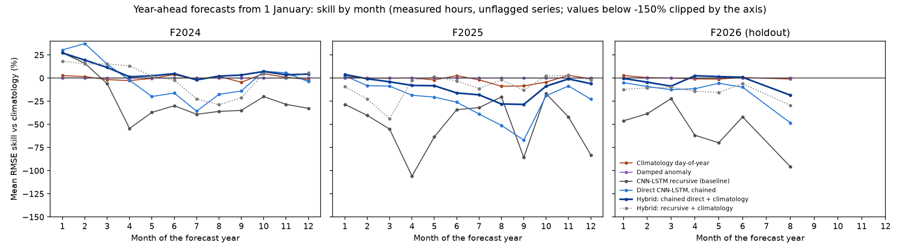
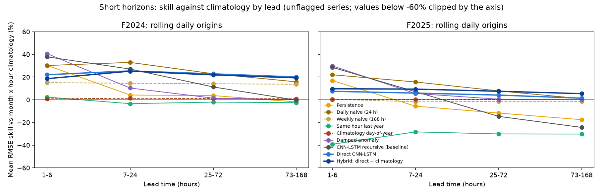
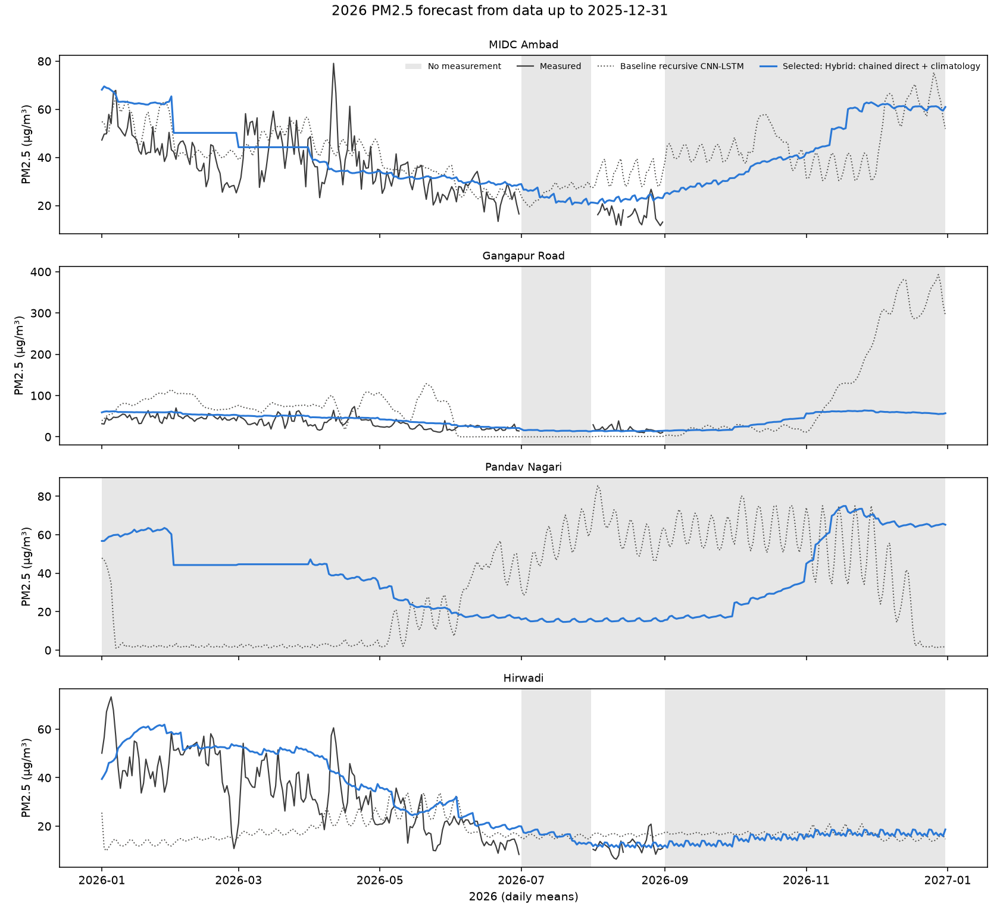

# Multi-horizon forecasting experiments: Nashik air quality

Branch `exp-multihorizon`, built on the baseline commit 7649c2d. Baseline code and `outputs/` are unchanged; every file here is under `experiments/`.

## Answer

- **Year ahead: the revised method does not beat climatology.** The method chosen by the pre-registered rule on the 2024 and 2025 backtests, *Hybrid: chained direct + climatology*, had a mean RMSE skill of +0.6% against month x hour climatology on those folds. That is a tie with day-of-year climatology (+0.4%). The whole margin came from Gangapur Road in 2024 (+12.3%). In 2025 it was -2.4%, and on the untouched 2026 holdout -2.5%, while day-of-year climatology scored +0.7%. For a forecast months ahead, climatology remains the best available estimate.
- **The revised method does remove the drift.** The baseline recursive CNN-LSTM scored -49.1% on the 2026 holdout. 23.2% of its station-pollutant-months had a mean more than 3 times above or below climatology. The selected hybrid scored -2.5%, with 1.5% of months outside that range.
- **Up to a week ahead, the direct multi-horizon model helps.** At the 168-hour horizon the best method in every fold was the direct model or its blend with climatology. The hybrid scored F2024 +20.8%, F2025 +6.6%, F2026 +7.7% RMSE skill against climatology (best in F2025 and F2026; in F2024 the plain direct model was slightly ahead at +21.6%). At 24 hours, simpler baselines are as good or better: the best method was Daily naive (24 h) in F2024 (+32.0%), Daily naive (24 h) in F2025 (+16.7%), Daily naive (24 h) in F2026 (+11.4%). The hybrid direct model scored +24.4%, +9.7%, +10.1% there.

## Setup

**Folds.** A fold is a training cutoff on 1 January. Validation is the 6 months before it (early stopping and blend weights), and training is everything earlier. Every scaler, imputer, network, climatology, AR coefficient and blend weight in a fold uses data before its cutoff only. F2024 and F2025 select the method. F2026 is a holdout, run only after `selection.json` was written; its run records the selection it saw, and `final` refuses to proceed if the selection changed afterwards. Measured 2026 values were never used to tune, select or weight anything.

A station takes part in a fold only if its first observation is at least 180 days before validation starts. MIDC Ambad, Hirwadi and Pandav Nagari start in May-June 2023, so F2024 is Gangapur Road only. Pandav Nagari has no 2026 measurements: it has a 2026 forecast but no 2026 score.

| Fold | Station | Status | Short-horizon origins with valid input | Possible origins | Year-ahead cells measured | Year-ahead cells |
|---|---|---|---|---|---|---|
| F2024 | MIDC Ambad | excluded (starts 2023-06-14) | 0 | 0 | 0 | 0 |
| F2024 | Gangapur Road | used | 355 | 360 | 58035 | 61488 |
| F2024 | Pandav Nagari | excluded (starts 2023-05-22) | 0 | 0 | 0 | 0 |
| F2024 | Hirwadi | excluded (starts 2023-05-23) | 0 | 0 | 0 | 0 |
| F2025 | MIDC Ambad | used | 359 | 359 | 58229 | 61320 |
| F2025 | Gangapur Road | used | 359 | 359 | 58074 | 61320 |
| F2025 | Pandav Nagari | used | 359 | 359 | 58384 | 61320 |
| F2025 | Hirwadi | used | 359 | 359 | 59204 | 61320 |
| F2026 | MIDC Ambad | used | 207 | 359 | 29798 | 61320 |
| F2026 | Gangapur Road | used | 207 | 359 | 27306 | 61320 |
| F2026 | Pandav Nagari | used | 1 | 359 | 0 | 61320 |
| F2026 | Hirwadi | used | 207 | 359 | 30564 | 61320 |

**Two protocols, scored on identical rows.**

1. *Short horizons.* A forecast is issued at 00:00 every day of the test year. Each needs a valid 168-hour input window: every hour present in the file, and at most half of the pollutant cells imputed. Inputs are measurements before the origin; models stay frozen at the cutoff. Leads 1-168 h are scored. The 24 h horizon is leads 1-24.
2. *Year ahead.* One forecast from 1 January 00:00 for every hour of the year, scored on measured hours.

Within a protocol, every method is scored on exactly the same station, hour and pollutant rows. Skill = 1 - RMSE_method / RMSE_climatology(month x hour), computed per station-pollutant series and then averaged. Series whose measured values take fewer than 100 distinct values are flagged as sensor faults and excluded from the averages (F2026: 4 series; none in F2024 or F2025).

**Methods.**

| Method | Definition |
|---|---|
| Climatology month x hour | mean for the same month and hour, all data before the cutoff (the reference) |
| Climatology day-of-year | mean for the same hour within +-15 days of the same day of year, used only where 2 or more years cover that window, otherwise month x hour |
| Persistence | last observed value |
| Daily / weekly naive | repeat the last 24 or 168 measured hours (falls back to climatology where those hours are missing) |
| Same hour last year | the value 364 days earlier, else climatology |
| Damped anomaly | climatology + phi^h x (last anomaly from climatology); phi is the lag-1 autocorrelation of training anomalies |
| CNN-LSTM recursive (baseline) | the existing one-step network, fed its own output. Saved baseline checkpoints for F2025 and F2026, retrained with the baseline recipe for F2024 |
| Direct CNN-LSTM | same network family with a 168 h input, predicting all 168 h x 7 pollutants in one pass (masked MSE, early stopping on validation). For the full year it is chained: each 168 h block becomes the next input |
| Hybrids | w x network + (1 - w) x climatology, with least-squares w in [0, 1] per station, pollutant and lead bucket, fitted on validation forecasts made by the models trained before validation, with climatology from data before validation. Leads up to 168 h use the daily validation origins; longer leads use one validation forecast run from the start of validation (July-December), and leads beyond 4,416 h reuse the last bucket |

**Physical constraint.** Concentrations cannot be negative, so network outputs are floored at zero before being fed back and on output, as in the baseline. The share of outputs that hit the floor is reported below. No upper cap is applied. Predictions above twice the training-period 99.9th percentile are counted: there were none in any fold.

## Year-ahead results

Mean RMSE skill against month x hour climatology, and the number of station-pollutant series where the method beats it. F2026 is the holdout.

| Method | F2024 skill % | F2025 skill % | F2026 skill % | F2024 series better | F2025 series better | F2026 series better |
|---|---|---|---|---|---|---|
| Persistence | -12.0 | -28.6 | -34.7 | 2/7 | 6/28 | 4/17 |
| Same hour last year | -2.0 | -30.0 | -41.5 | 3/7 | 3/28 | 2/17 |
| Climatology month x hour | 0.0 | 0.0 | 0.0 | 0/7 | 0/28 | 0/17 |
| Climatology day-of-year | 1.0 | 0.2 | 0.7 | 7/7 | 12/28 | 13/17 |
| Damped anomaly | 0.1 | 0.0 | 0.1 | 7/7 | 18/28 | 12/17 |
| CNN-LSTM recursive (baseline) | -9.3 | -39.4 | -49.1 | 2/7 | 6/28 | 1/17 |
| Direct CNN-LSTM, chained | 12.8 | -10.1 | -11.3 | 6/7 | 5/28 | 5/17 |
| Hybrid: chained direct + climatology | 12.3 | -2.4 | -2.5 | 7/7 | 11/28 | 8/17 |
| Hybrid: recursive + climatology | 6.9 | -11.0 | -14.2 | 3/7 | 15/28 | 1/17 |



By IMD season (mean skill %, measured hours only; F2026 has no post-monsoon measurements):

| fold | season | Climatology day-of-year | CNN-LSTM recursive (baseline) | Direct CNN-LSTM, chained | Hybrid: chained direct + climatology |
|---|---|---|---|---|---|
| F2024 | Monsoon | -0.2 | -24.7 | -17.6 | 2.0 |
| F2024 | Post-monsoon | 1.1 | -26.4 | 5.9 | 4.3 |
| F2024 | Pre-monsoon | -0.4 | -26.9 | 4.4 | 6.3 |
| F2024 | Winter | 1.5 | -0.5 | 23.6 | 18.2 |
| F2025 | Monsoon | -0.7 | -33.4 | -35.6 | -17.0 |
| F2025 | Post-monsoon | -0.5 | -34.4 | -11.0 | -2.7 |
| F2025 | Pre-monsoon | -0.2 | -62.4 | -12.8 | -6.3 |
| F2025 | Winter | 0.6 | -41.7 | -4.6 | 1.7 |
| F2026 | Monsoon | -1.7 | -57.9 | -22.8 | -3.3 |
| F2026 | Pre-monsoon | 0.0 | -47.1 | -5.2 | -0.1 |
| F2026 | Winter | 1.5 | -43.2 | -7.0 | -2.5 |

2026 holdout per series (unflagged):

| station | pollutant | n | Climatology day-of-year skill % | CNN-LSTM recursive (baseline) skill % | Hybrid: chained direct + climatology skill % |
|---|---|---|---|---|---|
| Gangapur Road | O3 | 4987 | 0.1 | -52.7 | 11.0 |
| Gangapur Road | PM10 | 4856 | 0.8 | -60.5 | 0.6 |
| Gangapur Road | PM2.5 | 4876 | 0.1 | -130.8 | -5.8 |
| Gangapur Road | SO2 | 4329 | -0.5 | -118.6 | 1.7 |
| Hirwadi | CO | 2524 | -0.0 | -32.5 | -4.4 |
| Hirwadi | NH3 | 4632 | 0.8 | -48.5 | -42.0 |
| Hirwadi | NO2 | 4520 | -1.6 | -73.5 | 33.3 |
| Hirwadi | O3 | 4779 | 0.6 | -12.9 | -3.4 |
| Hirwadi | PM10 | 4767 | 0.4 | -63.3 | -15.0 |
| Hirwadi | PM2.5 | 4769 | 3.4 | -87.8 | -20.1 |
| Hirwadi | SO2 | 4573 | 1.0 | -13.7 | 1.4 |
| MIDC Ambad | NH3 | 4654 | 0.0 | -20.3 | -4.3 |
| MIDC Ambad | NO2 | 4629 | 4.6 | -26.0 | 0.7 |
| MIDC Ambad | O3 | 4718 | -0.6 | -16.2 | -1.9 |
| MIDC Ambad | PM10 | 4710 | 1.5 | -16.0 | 4.2 |
| MIDC Ambad | PM2.5 | 4708 | 0.1 | 4.9 | -0.1 |
| MIDC Ambad | SO2 | 4708 | 2.0 | -66.9 | 1.7 |

Why the hybrid does not generalise: its long-lead weights are fitted on a single validation trajectory (July-December), and they stay high. In F2026, the weights for leads over 168 h average 0.61 (range 0.00-1.00), so the network still carries most of the forecast where it has no skill. Weights fitted over several origins or years, or shrunk towards zero with lead, are the obvious next step. That step would need a new selection fold, because 2026 can no longer be used for it.

## Short-horizon results

Mean RMSE skill against month x hour climatology, rolling daily origins:

| Method | F2024 24h % | F2025 24h % | F2026 24h % | F2024 168h % | F2025 168h % | F2026 168h % |
|---|---|---|---|---|---|---|
| Persistence | 11.4 | -1.5 | -0.4 | 1.5 | -13.7 | -16.7 |
| Daily naive (24 h) | 32.0 | 16.7 | 11.4 | 20.0 | 5.0 | -1.7 |
| Weekly naive (168 h) | 14.3 | -1.3 | -7.9 | 13.9 | -1.4 | -7.9 |
| Same hour last year | -1.9 | -30.1 | -41.4 | -2.3 | -30.2 | -41.9 |
| Climatology month x hour | 0.0 | 0.0 | 0.0 | 0.0 | 0.0 | 0.0 |
| Climatology day-of-year | 1.2 | 0.3 | 0.7 | 1.0 | 0.2 | 0.7 |
| Damped anomaly | 15.9 | 9.7 | 10.3 | 2.5 | 1.5 | 1.6 |
| CNN-LSTM recursive (baseline) | 30.2 | 11.0 | 11.0 | 6.7 | -17.8 | -19.8 |
| Direct CNN-LSTM | 25.1 | 6.4 | 5.9 | 21.6 | 2.9 | 2.1 |
| Hybrid: direct + climatology | 24.4 | 9.7 | 10.1 | 20.8 | 6.6 | 7.7 |

F2025, skill % by lead bucket (all four stations):

| Method | 1-6 h | 7-24 h | 25-72 h | 73-168 h |
|---|---|---|---|---|
| Persistence | 16.9 | -5.6 | -11.7 | -17.5 |
| Daily naive (24 h) | 22.1 | 15.7 | 7.8 | 1.0 |
| Weekly naive (168 h) | 0.6 | -1.8 | -1.4 | -1.4 |
| Same hour last year | -39.2 | -28.3 | -30.1 | -30.2 |
| Climatology month x hour | 0.0 | 0.0 | 0.0 | 0.0 |
| Climatology day-of-year | 0.3 | 0.3 | 0.2 | 0.1 |
| Damped anomaly | 29.9 | 5.5 | 0.5 | 0.0 |
| CNN-LSTM recursive (baseline) | 28.6 | 7.2 | -14.6 | -24.3 |
| Direct CNN-LSTM | 7.5 | 5.9 | 4.1 | 1.4 |
| Hybrid: direct + climatology | 9.7 | 9.4 | 7.5 | 5.4 |



The best method changes with lead. For the first hours, the last measurement carries most of the information (damped anomaly, recursive CNN-LSTM). Within a day, the daily naive forecast is hard to beat. From 3 to 7 days ahead, the hybrid direct model leads. 24 h results by season are in `metrics/short_horizon_24h_by_season.csv`.

## Drift and constraint diagnostics

Monthly mean forecast divided by monthly mean climatology, over every hour of the year (measured or not); the hybrids are blends of floored outputs, so they have no floor count of their own.

| fold | method | months outside 1/3-3x clim (share) | max monthly ratio | min monthly ratio | values > 2x p99.9 | % outputs floored at 0 |
|---|---|---|---|---|---|---|
| F2024 | CNN-LSTM recursive (baseline) | 0.429 | 1.595 | 0.064 | 0 | 1.677 |
| F2024 | Direct CNN-LSTM, chained | 0.083 | 1.697 | 0.060 | 0 | 1.977 |
| F2024 | Hybrid: chained direct + climatology | 0.048 | 1.207 | 0.161 | 0 | - |
| F2024 | Hybrid: recursive + climatology | 0.036 | 1.595 | 0.125 | 0 | - |
| F2025 | CNN-LSTM recursive (baseline) | 0.101 | 4.701 | 0.020 | 0 | 0.783 |
| F2025 | Direct CNN-LSTM, chained | 0.012 | 3.415 | 0.227 | 0 | 0.139 |
| F2025 | Hybrid: chained direct + climatology | 0.003 | 3.390 | 0.454 | 0 | - |
| F2025 | Hybrid: recursive + climatology | 0.006 | 3.621 | 0.341 | 0 | - |
| F2026 | CNN-LSTM recursive (baseline) | 0.232 | 8.973 | 0.000 | 0 | 5.951 |
| F2026 | Direct CNN-LSTM, chained | 0.065 | 6.361 | 0.099 | 0 | 0.215 |
| F2026 | Hybrid: chained direct + climatology | 0.015 | 4.439 | 0.281 | 0 | - |
| F2026 | Hybrid: recursive + climatology | 0.006 | 3.674 | 0.326 | 0 | - |

## Deliverable: 2026 forecast

`forecast_2026_selected.csv` has 8,760 hours x 7 pollutants x 4 stations = 245,280 rows. Its forecast column is the selected method, Hybrid: chained direct + climatology: trained, early-stopped and weighted on data up to 2025-12-31. Alongside it are the month x hour climatology and the baseline recursive CNN-LSTM, plus `actual` and `ground_truth` (`observed` / `missing_value` / `no_row_in_file`). July and September-December 2026, and all of Pandav Nagari, have no ground truth.



Plausibility check: 14 of 336 station-pollutant-months of the deliverable have a monthly mean below half or above twice climatology. Most fall in months with no measurement to check against:

| station | pollutant | months | lowest_ratio | highest_ratio |
|---|---|---|---|---|
| Gangapur Road | NO2 | Jan, Feb | 0.38 | 0.44 |
| Hirwadi | NH3 | Aug, Sep, Oct, Nov, Dec | 2.45 | 4.44 |
| Hirwadi | PM10 | Nov | 0.49 | 0.49 |
| Hirwadi | PM2.5 | Oct, Nov, Dec | 0.28 | 0.35 |
| Pandav Nagari | NO2 | Jun, Jul, Aug | 0.42 | 0.49 |

Hirwadi PM2.5 is the clearest case. The forecast stays near 17 µg/m³ in November against a climatology of 60, because that series' long-lead blend weight is high and the chained network shows no winter rise.

Given the holdout result, use the `clim_month_hour` column (or day-of-year climatology) for months-ahead planning. The selected hybrid is reported because it is what the pre-registered rule chose, not because it won.

## Limitations

- Few independent years: method selection rests on 35 station-pollutant series from two folds, one of which is Gangapur Road alone. Margins under about 1% are not distinguishable from noise; no confidence intervals or multiple seeds.
- Three stations have about 1.5 years of training data in F2025, and F2024 cannot use them at all. Day-of-year climatology falls back to month x hour wherever fewer than two years cover the window; for those stations in F2025 that is roughly January-May (only 2024 covers it).
- Validation is always July-December, so blend weights and early stopping are tuned on monsoon and post-monsoon behaviour only.
- The direct model's best validation epoch was between 1 and 7 in every fold, so it is lightly trained. Its skill decays with lead (F2025: +7.5% at 1-6 h, +1.4% at 73-168 h).
- 2026 holdout covers January-June and August at three stations; flagged sensor series (Gangapur Road NO2, CO, NH3; MIDC Ambad CO) are excluded from its averages.
- Meteorological inputs remain unused (missing or inconsistent sensors), which caps what any multi-day forecast can learn.

## Reproduce

```bash
cd ~/nashik-aqi-cnn-lstm   # branch exp-multihorizon; data/ holds the four CSVs
# the baseline checkpoints in outputs/backtest_2025 and outputs/forecast_2026 must exist
.venv/bin/python experiments/exp_multihorizon.py fold F2024
.venv/bin/python experiments/exp_multihorizon.py fold F2025
.venv/bin/python experiments/exp_multihorizon.py select
.venv/bin/python experiments/exp_multihorizon.py fold F2026   # holdout, after select
.venv/bin/python experiments/exp_multihorizon.py final
.venv/bin/python experiments/exp_multihorizon.py diagnose
.venv/bin/python experiments/exp_multihorizon.py report
.venv/bin/python -m unittest discover tests -v
```

Each fold takes about 2.5-3.5 minutes on a 10-core laptop CPU; diagnose about 2 minutes. Seeds are fixed (42). Retraining on another TensorFlow build can change the networks slightly, and with margins this small that could change the selection.
